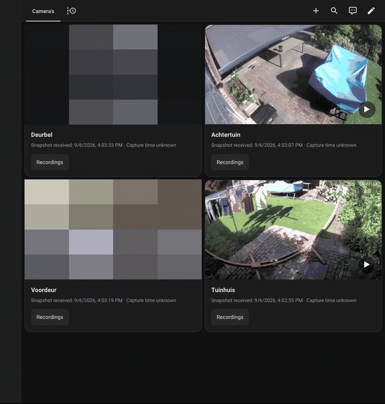

# Eufy Security Viewer

View snapshots, watch live video with optional sound, and browse existing
HomeBase recordings in Home Assistant, for Eufy cameras connected to a
HomeBase 3 (T8030). This is an independent project, not affiliated with Eufy or
Anker.

[Install](#installation) · [Upgrade](#upgrading) · [Compatibility and help](#compatibility-and-help)



## What you get

- A camera entity for each supported Eufy camera, showing the latest received
  snapshot. The integration never wakes a camera to refresh it.
- Live video after a tap on the **Eufy Security Viewer** card, through WebRTC
  with optional sound. When WebRTC is unavailable or fails, the card shows JPEG
  video without sound.
- The **Eufy Events** card to browse and play existing HomeBase recordings
  across your cameras.
- Camera event entities, battery sensors, and HomeBase alarm and Guard Mode
  entities for automations. See [events and notifications](docs/NOTIFICATIONS.md).

Talkback, PTZ control, recording live video, HLS and permanent RTSP streams are
not provided.
See [snapshot and streaming limits](docs/USAGE.md#honest-snapshot-and-streaming-limits).

## Before you start

- Home Assistant **2026.9.0 or newer** and [HACS](https://hacs.xyz/docs/use/download/download/).
- Eufy cameras connected to a HomeBase 3 (T8030) for snapshots, live view and
  recordings. Other HomeBase models, such as HomeBase 2 or HomeBase Mini, and
  NVR setups are not supported. Cameras without a HomeBase normally show these
  features as unsupported, but two models can try an
  [experimental standalone option](docs/USAGE.md#experimental-standalone-cameras).
- A Eufy account that can see your cameras in the Eufy app. A dedicated Eufy
  account with shared access to your cameras is recommended. A Eufy cloud
  recording subscription is not needed for the tested HomeBase recordings.
- A 64-bit Intel/AMD (amd64) or 64-bit ARM (aarch64) machine for the Home
  Assistant OS app. Only amd64 is tested on hardware. Testing on a 64-bit
  Raspberry Pi is pending, and there is no 32-bit ARM build.
  [Check compatibility](docs/COMPATIBILITY.md).

Install both parts:

- **Eufy Security Viewer Bridge** connects to your cameras. Run it as a Home
  Assistant OS app or in Docker on your local network.
- **Eufy Security Viewer** adds the integration and dashboard cards through HACS.
  HACS does not install or update the bridge.

## Installation

Already installed? Follow the [upgrade guide](#upgrading) instead.

### 1. Install the bridge on Home Assistant OS

Using Home Assistant Container or a separate bridge machine? Follow the
[Docker instructions](docs/DOCKER.md), then continue with step 2.

1. Open **Settings → Apps → Install app → ⋮ → Repositories** and add:

   ```text
   https://github.com/keesmod/ha-eufy-cam
   ```

2. Install **Eufy Security Viewer Bridge**.
3. In its configuration, set `token` to a unique random secret of at least
   32 characters. A password manager can generate one. Keep it for the next
   step. This is not your Eufy password.
4. Start the app and enable **Start on boot**.

### 2. Install and connect the HACS integration

1. In **HACS → ⋮ → Custom repositories**, add the same repository URL as an
   **Integration**.
2. Download **Eufy Security Viewer** and restart Home Assistant.
3. Open **Settings → Devices & services → Add integration → Eufy Security Viewer**.
4. Enter `http://127.0.0.1:8063` for the Home Assistant OS app, or the bridge
   address from your Docker setup. Enter the token you saved above.
5. Sign in with your Eufy email, password and two-letter country code, such as
   `NL`. Complete any verification step and check that your cameras appear.

[Detailed installation and troubleshooting](docs/INSTALLATION.md)

### 3. Add the dashboard cards

Reload your browser, edit a dashboard and select **Add card → Eufy Security
Viewer**. Pick a camera. Add **Eufy Events** to browse recordings across cameras.
The cards are included with the integration.

Tap a camera to watch live video and enable sound if wanted. Close the viewer
when finished.

By default the live view opens as a popup and one camera per HomeBase is live
at a time. To watch several cameras at once:

- Set **Live view** to **Inside the card** in each card's editor.
- For cameras on the same HomeBase, also raise the bridge option
  `live_max_streams_per_station` (default 1). See
  [live cameras per HomeBase](docs/USAGE.md#live-cameras-per-homebase) for the
  value that suits your host.

See [card options](docs/USAGE.md#card-options) for YAML and automatic live start.

<details>
<summary>Cards missing or resources managed in YAML?</summary>

The current card resource is `/eufy_viewer/eufy-viewer-card.js?v=0.8.46`.
See [manual card setup](docs/INSTALLATION.md#3-add-the-dashboard-cards).

</details>

## Upgrading

<!-- Keep this section to the current release pair. Version history belongs in CHANGELOG.md and the GitHub release notes. -->

The current release is integration **0.8.46** with bridge **0.8.37**, which
bundles the [Eufy Mega client](https://github.com/keesmod/eufy-mega-client)
library **0.29.2**. Update both parts. The
[release notes](https://github.com/keesmod/ha-eufy-cam/releases/latest) list
the changes and any version-specific steps. Earlier versions are described in
the [GitHub releases](https://github.com/keesmod/ha-eufy-cam/releases) and the
integration [CHANGELOG.md](CHANGELOG.md).

**Upgrading from before 0.8.0?** Follow the
[migration and recovery instructions](docs/MEGA_MIGRATION.md) instead of the
steps below. That upgrade removes the old backend, and the integration must be
updated before the bridge.

For installations already on 0.8.0 or newer:

1. Close live viewers and recordings. Back up Home Assistant and the bridge's
   private data.
2. In **Settings → Apps**, update **Eufy Security Viewer Bridge** to the
   version named in the release notes. For Docker, follow the
   [Docker update steps](docs/DOCKER.md#update-the-docker-bridge).
3. Update **Eufy Security Viewer** in HACS and restart Home Assistant.
4. Reload your dashboard and check snapshots, live video, recordings and events.
   If you manage card resources in YAML, use the resource URL under
   [3. Add the dashboard cards](#3-add-the-dashboard-cards).

Keep your existing integration, token, bridge data and backup. Do not run two
Eufy Security Viewer bridges for the same installation at once.

## Compatibility and help

You can install or upgrade without maintainer test results for your exact
camera. Available functions still depend on the model and connection. The
[known results and limitations](docs/COMPATIBILITY.md) separate confirmed
behavior, owner reports and models recognized in software only.

- **Something does not work?** Check
  [troubleshooting](docs/INSTALLATION.md#troubleshooting). For failed setup or
  missing devices, collect a [complete diagnostic report](docs/DISCOVERY_DIAGNOSTICS.md).
- **Live video falls back without sound?** Check the WebRTC requirements under
  [snapshot and streaming limits](docs/USAGE.md#honest-snapshot-and-streaming-limits).
  Then follow [live playback diagnostics](docs/LIVE_DIAGNOSTICS.md) to download
  the integration diagnostics after one attempt.
- **Recording or player error?** Use **Download diagnostics** at the error or in
  the integration menu. See [the playback report](docs/PLAYBACK_REPORT.md).
- **Share your experience:** [report working or failing features](https://github.com/keesmod/ha-eufy-cam/issues/new?template=compatibility.yml).
  Partial results help. Reporting is voluntary.
- **Found a bug?** Add your results to a matching existing issue, or
  [report a bug](https://github.com/keesmod/ha-eufy-cam/issues/new?template=bug_report.yml).
  [Remove private information](.github/SUPPORT.md#safe-diagnostics) before sharing logs.

## Documentation

For users:

- [Playback, recovery and technical details](docs/USAGE.md)
- [Detailed installation and troubleshooting](docs/INSTALLATION.md)
- [Run the bridge in Docker](docs/DOCKER.md)
- [Camera events and recognized people](docs/NOTIFICATIONS.md)
- [Compatibility and community testing](docs/COMPATIBILITY.md)
- [Experimental NVIDIA acceleration for the Docker bridge](docs/NVIDIA.md)

For contributors: [architecture](docs/ARCHITECTURE.md),
[development](docs/DEVELOPMENT.md) and [release process](docs/RELEASING.md).

## Support this project

If this project is useful to you, consider
[buying me a coffee](https://buymeacoffee.com/keesmod) to support its maintenance
and development. Contributions are optional.
